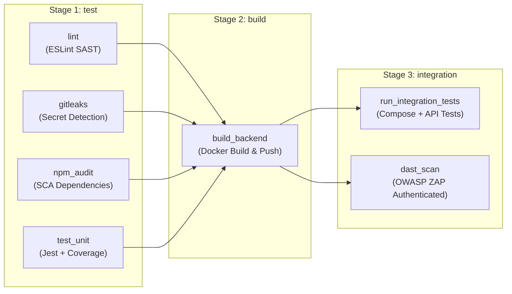

# 🛡️ Secure File Cloud — DevSecOps & Cloud-Native Security Architecture

[](#3-devsecops-cicd-pipeline-automated-security-gates)
[](#5-dynamic-application-security-testing-dast--dast_scan)
[](#1-secret-leak-detection-gitleaks)
[](#4-container--host-security-hardening-docker)
[](#5-identity--access-management-iam)
[](#9-cloud-native--kubernetes-security-roadmap)

---

> ### 📍 Architectural Phase & Cloud Hosting Notice
> **Current State:** **Phase 1 — Hardened Baseline Architecture (Containerized Microservices)**  
> This phase establishes a hardened local foundation: isolated Docker networks, non-root containers, centralized IAM, and automated shift-left CI/CD security gates.  
> **Target Production State:** **Phase 2 — Kubernetes Cloud Deployment (Active Roadmap)**  
> This baseline is engineered specifically to migrate into a **Cloud-Hosted Kubernetes Cluster (EKS / GKE / k3s)** with Zero-Trust Pod Security Standards and `NetworkPolicy` microsegmentation (tracked in [`K8S_MILESTONES.md`](file:///c:/Users/dawid/Desktop/portfo/file%20cloud/K8S_MILESTONES.md)).

---

## ⚡ Project Summary

*Target Roles: **DevSecOps Engineer**, **Cloud Security Engineer**, **Application Security (AppSec)**, **SOC / Security Analyst**.*

| Domain | Used Technologies | Real-World Implementation Highlight |
| :--- | :--- | :--- |
| **Shift-Left CI/CD** | GitLab CI, Gitleaks, npm audit, ESLint | Automated commit-history secret detection & dependency CVE audits blocking merges. |
| **Dynamic Testing (DAST)** | OWASP ZAP Baseline, curl| **Authenticated DAST:** Pipeline programmatically fetches Keycloak JWT Bearer tokens to scan protected endpoints. |
| **Container Hardening** | Docker, Nginx Unprivileged, Alpine | **Rootless Execution:** Backend runs as `node:node`, Nginx runs unprivileged on port 8080. |
| **Identity & Access (IAM)**| Keycloak, OAuth 2.0, OpenID Connect | **Stateless Verification:** Backend validates tokens asymmetrically via Keycloak's public JWKS endpoint (zero secrets stored). |
| **Defensive AppSec** | Helmet, express-rate-limit, Postgres | HSTS/CSP headers, IP rate limiting against brute force, and 100% parameterized SQL queries (SQLi immune). |
| **Cloud & K8s Roadmap (in future)** | Kubernetes, Pod Security, NetworkPolicy | Active migration to cloud-hosted K8s with rootless `securityContext` and database traffic microsegmentation. |

---

## 📑 Table of Contents
1. [About the Project](#1-about-the-project)
2. [Security Controls & Standards Matrix](#2-security-controls--standards-matrix)
3. [DevSecOps CI/CD Pipeline (Automated Security Gates)](#3-devsecops-cicd-pipeline-automated-security-gates)
4. [Container & Host Security Hardening (Docker)](#4-container--host-security-hardening-docker)
5. [Identity & Access Management (IAM)](#5-identity--access-management-iam)
6. [Application Security & Defensive Controls (AppSec)](#6-application-security--defensive-controls-appsec)
7. [Key Architectural Decisions](#7-key-architectural-decisions)
8. [Known Limitations & Production Threat Model](#8-known-limitations--production-threat-model)
9. [Cloud-Native & Kubernetes Security Roadmap](#9-cloud-native--kubernetes-security-roadmap)
10. [Quickstart & Verification](#10-quickstart--verification)

---

## 1. About the Project

### User Perspective
**File Cloud** is a self-hosted personal cloud storage platform that allows users to organize, upload, download, and manage their documents and folders through a responsive, modern web interface.

### Technical Architecture
The system is built as a multi-tier microservices architecture featuring an **Nginx unprivileged web frontend**, a **Node.js REST API backend**, a **PostgreSQL database** for metadata persistence, and a centralized **Keycloak Identity Provider**.

### DevSecOps & Security Mission
Rather than treating security as an afterthought, this repository is engineered from the ground up to demonstrate **Security by Design**, **Defense-in-Depth**, and **Shift-Left Security Automation**. Every commit and pull request is systematically audited through automated CI/CD security gates, container hardening rules, and defensive application controls.

---

## 2. Security Controls & Standards Matrix

| Security Domain | Applied Defensive Control / Tool | Industry Standard / Framework |
| :--- | :--- | :--- |
| **Pipeline Secrets** | Gitleaks historical Git scanning | **OWASP Top 10: A07:2021** (Identification & Auth Failures) |
| **Dependency Security** | Automated `npm audit` gate | **OWASP Top 10: A06:2021** (Vulnerable & Outdated Components) |
| **Code Hygiene (SAST)** | Static AST analysis via ESLint | **OWASP Top 10: A04:2021** (Insecure Design) |
| **Dynamic Security (DAST)** | Authenticated OWASP ZAP Baseline with Bearer token injection | **NIST SP 800-115** / **OWASP DAST** |
| **Container Runtimes** | Rootless execution (`node`, `nginx-unprivileged`), minimal Alpine bases | **CIS Docker Benchmark v1.6.0** / **NIST SP 800-190** |
| **Host Exposure** | Local loopback binding (`127.0.0.1`) on all host mappings | **Principle of Least Exposure** |
| **Identity & IAM** | Centralized Keycloak OIDC, RS256 token verification via JWKS | **OAuth 2.0 (RFC 6749)** / **OpenID Connect Core 1.0** |
| **API Defense (AppSec)** | Helmet HTTP headers, IP rate limiting, parameterized SQL queries | **OWASP ASVS v4.0** / **OWASP Top 10: A03:2021** (Injection) |
| **Observability** | Structured audit logging capturing timestamp, remote IP, and status | **OWASP Top 10: A09:2021** (Security Logging & Monitoring) |

---

## 3. DevSecOps CI/CD Pipeline (Automated Security Gates)

The project leverages a multi-stage **GitLab CI/CD** pipeline (`.gitlab-ci.yml`) enforcing automated security testing before code reaches build and staging phases. Every box in the workflow corresponds 1:1 to an automated job in the pipeline:



### 1. Secret Leak Detection (`gitleaks`)
* **Tool:** `zricethezav/gitleaks`
* **Execution:** Scans the full Git commit graph (`GIT_DEPTH: 0`) on every merge request and push.
* **Output:** Generates `gitleaks-report.json` as an exported pipeline artifact.
* **Protection:** Halts the pipeline immediately if private keys, API tokens, or credentials are inadvertently committed.

### 2. Software Composition Analysis (`npm_audit`)
* **Tool:** `npm audit --audit-level=high`
* **Objective:** Automatically discovers known CVEs and transitively vulnerable third-party dependencies before image assembly.

### 3. Static Analysis & Unit Verification (`lint` & `test_unit`)
* **Tool:** ESLint + Jest with JUnit reporting (`jest-junit`).
* **Coverage:** Validates API route handlers, sanitization logic, and authentication middleware isolation.

### 4. Ephemeral Stack Integration Testing (`run_integration_tests`)
* **Execution:** Automatically orchestrates `docker compose up -d --wait` in CI (Docker-in-Docker) to spin up live Postgres, Keycloak, Backend, and Frontend containers.
* **Verification:** Executes comprehensive end-to-end API integration tests (`jest integration_tests`) verifying real database interactions and health probe endpoints.

### 5. Dynamic Application Security Testing (DAST — `dast_scan`)
Most basic DAST implementations only scan unauthenticated landing pages, missing the entire attack surface. This pipeline performs **authenticated automated scanning**:
1. Spawns an ephemeral stack (`docker compose up -d --wait`) inside the CI runner.
2. Programmatically negotiates an **OAuth2 OpenID Connect Bearer token** from Keycloak via the Direct Access Grant flow using `curl` and `jq`:
   ```bash
   ACCESS_TOKEN=$(curl -s -X POST "http://docker:8080/realms/file-cloud/protocol/openid-connect/token" \
     -H "Host: localhost:8080" \
     -d "grant_type=password&client_id=file-cloud-client&username=test-user&password=test-user" | jq -r .access_token)
   ```
3. Dynamically injects the retrieved Bearer token into **OWASP ZAP** (`ghcr.io/zaproxy/zaproxy:stable`) using its header replacer engine:
   ```bash
   -z "-config replacer.full_list(0).description=auth \
       -config replacer.full_list(0).enabled=true \
       -config replacer.full_list(0).matchtype=REQ_HEADER \
       -config replacer.full_list(0).matchstr=Authorization \
       -config replacer.full_list(0).replacement=\"Bearer ${ACCESS_TOKEN}\""
   ```
4. Scans protected endpoints (e.g., `/api/auth/me`, `/api/files`) and exports `zap-report.html` and `zap-report.json`.

---

## 4. Container & Host Security Hardening (Docker)

All container images and service orchestrations follow Docker security recommendations:

* **Principle of Least Privilege (Rootless Containers):**
  * **Backend:** Runs explicitly under the unprivileged `node` user (`USER node`) with non-root ownership (`chown -R node:node /app`).
  * **Frontend:** Built upon `nginxinc/nginx-unprivileged:alpine`, running under an unprivileged UID (101) binding to non-reserved port `8080`.
* **Attack Surface Reduction:**
  * Base images utilize minimal Alpine distributions (`node:24-alpine`, `nginx:alpine`).
  * Development dependencies and build tools are completely stripped from production images via `npm ci --omit=dev`.
* **Localhost Loopback Isolation:**
  * By default, `docker-compose.yml` binds service ports exclusively to the loopback adapter (`127.0.0.1:${PORT}`), preventing accidental exposure to the host's public IP or local network segment.
* **Read-Only Volume Enforcements (`:ro`):**
  * Database initialization scripts (`/docker-entrypoint-initdb.d/`) and Keycloak realm definitions (`realm-export.json`) are mounted as read-only volumes, guarding against tampering from within running containers.
* **Healthcheck-Driven Dependency Graph:**
  * Services define robust container healthchecks (`pg_isready`, TCP probe, `wget --spider`). Downstream services use `condition: service_healthy` to eliminate race conditions and startup vulnerabilities.

---

## 5. Identity & Access Management (IAM)

Authentication and authorization are externalized to **Keycloak** to maintain a strict separation of concerns and avoid rolling custom authentication mechanisms:

* **OpenID Connect (OIDC) & OAuth 2.0:** Standardized authentication flow with centralized token issuance, user lifecycle management, and session revocation.
* **Asymmetric Signature Verification (JWKS):**
  * The Node.js backend never shares or stores symmetric secrets.
  * Tokens are cryptographically validated using public keys fetched dynamically from Keycloak's JSON Web Key Set.
* **Zero Credential Exposure:**
  * Passwords and authentication hashes never enter or transit the application database. The application only processes short-lived, cryptographically signed JWT access tokens.

---

## 6. Application Security & Defensive Controls (AppSec)

Defensive programming practices implemented across the backend service:

* **Defensive HTTP Headers (`helmet`):** Configured to automatically inject security headers, enforcing HTTP Strict Transport Security (HSTS), Content Security Policy (CSP), `X-Content-Type-Options: nosniff`, and Clickjacking protection (`X-Frame-Options`).
* **DoS & Brute-Force Rate Limiting (`express-rate-limit`):** Protects sensitive API routes by restricting traffic to 100 requests per 10-minute window per IP, mitigating automated brute-force attacks and resource exhaustion.
* **Injection Defense:** All database interactions with PostgreSQL utilize parameterized queries via parameterized queries, mathematically preventing SQL Injection (SQLi).
* **CORS Whitelisting:** Cross-Origin Resource Sharing is strictly constrained to approved frontend origins, rejecting unauthorized cross-origin preflights.
* **Audit Trail & Logging (`morgan`):** All incoming transactions are timestamped in ISO-8601 format alongside remote IP addresses, HTTP verbs, URL routes, response codes, and round-trip latencies for security auditing and forensic investigation.

---

## 7. Key Architectural Decisions

* **Keycloak (OIDC) over In-App Auth:** Offloads credential handling entirely. The application database stores zero passwords or hashes, preventing credential theft even if the backend or database is compromised.
* **Asymmetric JWKS (RS256) over Shared Secrets (HS256):** Backend verifies tokens statelessly using Keycloak's public keys. A compromised backend cannot forge tokens because it never possesses the private signing key.
* **Authenticated DAST over Surface Scanning:** Public endpoints expose zero business logic. Programmatically injecting OAuth2 Bearer tokens enables OWASP ZAP to dynamically test protected file APIs, traversal, and access controls.
* **Docker Compose Baseline over Immediate Kubernetes:** Isolates failure domains. It validates container hardening, healthchecks, and CI security gates first before introducing Kubernetes Ingress and volume orchestration complexity.

---

## 8. Known Limitations & Production Threat Model

Engineering mature security architectures requires acknowledging trade-offs and defining clear paths to production hardening:

| Architectural Component | Current Implementation (Dev / Staging) | Production Hardening Roadmap | Threat Addressed |
| :--- | :--- | :--- | :--- |
| **File Storage** | Local container volume mounts (`/uploads`) | S3-compatible Object Storage (MinIO / AWS S3) with Server-Side Encryption (SSE-KMS) | Data theft from compromised storage volumes; unauthorized data access. |
| **Rate Limiting** | Single-process in-memory limiter | Distributed Redis-backed rate limiting | Bypass of rate limits when scaling across multiple horizontal backend replicas. |
| **Transport Layer** | Plain HTTP over internal Docker bridge network | Ingress TLS termination (Let's Encrypt / cert-manager) + mTLS Service Mesh (Linkerd / Istio) | Man-in-the-Middle (MitM) sniffing between internal services. |
| **Keycloak Execution** | Dev mode (`start-dev`) with automated realm import | Clustered production build, PostgreSQL with TLS, hardened admin console behind VPN | IAM service denial of service; unauthorized realm configuration alterations. |
| **Secrets Storage** | `.env` file loaded via Docker Compose | External Secrets Operator (HashiCorp Vault / AWS Secrets Manager) | Exposure of secrets through disk snooping or environment variable dumps. |

---

## 9. Cloud-Native & Kubernetes Security Roadmap

### Evolution from Local Baseline to Cloud-Hosted Kubernetes
While **Docker Compose** serves as the initial **foundational base step** to validate container hardening, local network isolation, and automated CI/CD security scanning, the final architectural target is a **production Cloud-Hosted Kubernetes cluster** (e.g. AWS EKS, GCP GKE, or self-hosted k3s/k8s).

The migration path follows an iterative, security-first roadmap tracked in detail in [`K8S_MILESTONES.md`](file:///c:/Users/dawid/Desktop/portfo/file%20cloud/K8S_MILESTONES.md):

* **Milestone 1–3 (Cluster Infrastructure & Ingress):** Transitioning services to Kubernetes Deployments, PVC durable storage for PostgreSQL, Ingress controller routing (eliminating ad-hoc port publishing), and Kube-DNS service discovery.
* **Milestone 4 (Stateful Storage Persistence):** Durable volume claims (`ReadWriteOnce`/`ReadWriteMany`) for user file uploads resisting pod restarts and horizontal scaling.
* **Milestone 5 (DevSecOps Hardening & Pod Security Standards):**
  * **Strict `securityContext`:** Dropping all Linux kernel capabilities, enforcing `runAsNonRoot: true`, and locking containers into `readOnlyRootFilesystem`:
    ```yaml
    securityContext:
      runAsNonRoot: true
      runAsUser: 1000
      allowPrivilegeEscalation: false
      readOnlyRootFilesystem: true
      capabilities:
        drop: ["ALL"]
    ```
  * **Zero-Trust Network Microsegmentation:** Implementing Kubernetes `NetworkPolicy` objects ensuring that PostgreSQL accepts ingress connections *strictly* from Backend pods on port 5432, preventing lateral movement within the cluster.
  * **Health Probes:** Liveness, readiness, and startup probes to automate self-healing and zero-downtime rolling updates.
* **Milestone 6 (Shift-Left Manifest Validation in CI/CD):** Integrating `kubeconform` and `trivy config` into the GitLab CI pipeline to statically analyze Kubernetes YAML manifests for CVEs and privilege misconfigurations before deployment to the cloud.

---

## 10. Quickstart & Verification

### Prerequisites
* Docker & Docker Compose (`v24.0+`)
* Node.js `v20+` (optional, for running local linters/tests)
* Git

### 1. Environment Setup
Clone the repository and copy the example environment configuration:
```bash
git clone <repository-url>
cd "file cloud"
cp .env.example .env
```
*(Review and customize secure passwords inside `.env` before booting)*.

### 2. Launch the Hardened Stack
Start the multi-tier container architecture:
```bash
docker compose up -d --build
```
Verify container health statuses:
```bash
docker compose ps
```
The services will be exposed strictly on localhost:
* **Frontend:** `http://localhost:3000`
* **Backend API:** `http://localhost:5000`
* **Keycloak IAM:** `http://localhost:8080`

### 3. Running Security Scans Locally

**Secret Scanning:**
```bash
docker run --rm -v $(pwd):/path zricethezav/gitleaks:v8.18.2 detect --source=/path --verbose
```

**Dependency Vulnerability Audit:**
```bash
cd backend && npm audit --audit-level=high
```

**Running Authenticated DAST (OWASP ZAP):**
```bash
# 1. Fetch access token from running Keycloak instance
TOKEN=$(curl -s -X POST "http://localhost:8080/realms/file-cloud/protocol/openid-connect/token" \
  -H "Content-Type: application/x-www-form-urlencoded" \
  -d "grant_type=password&client_id=file-cloud-client&username=test-user&password=test-user" | jq -r .access_token)

# 2. Trigger ZAP Baseline scan with injected header
docker run --rm --network host ghcr.io/zaproxy/zaproxy:stable \
  zap-baseline.py -t http://127.0.0.1:5000/api/auth/me \
  -r zap-report.html \
  -z "-config replacer.full_list(0).description=auth -config replacer.full_list(0).enabled=true -config replacer.full_list(0).matchtype=REQ_HEADER -config replacer.full_list(0).matchstr=Authorization -config replacer.full_list(0).replacement=\"Bearer ${TOKEN}\""
```
Scan reports (`zap-report.html` and `zap-report.json`) will be generated in your working directory.

---

## License & Attribution
Distributed under the ISC License. Designed and developed as a specialized DevSecOps & Cloud Security engineering showcase.